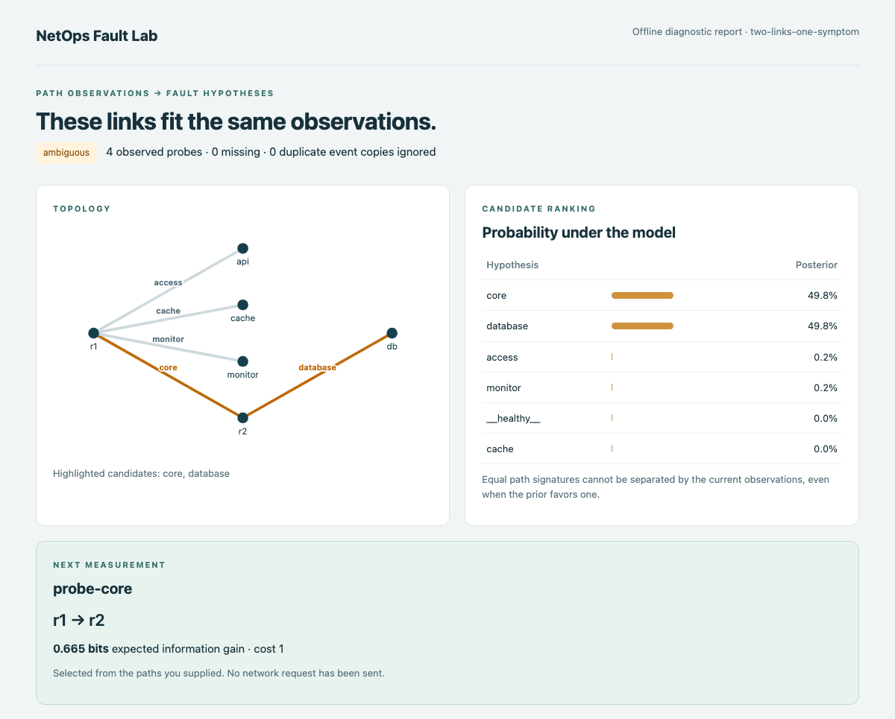
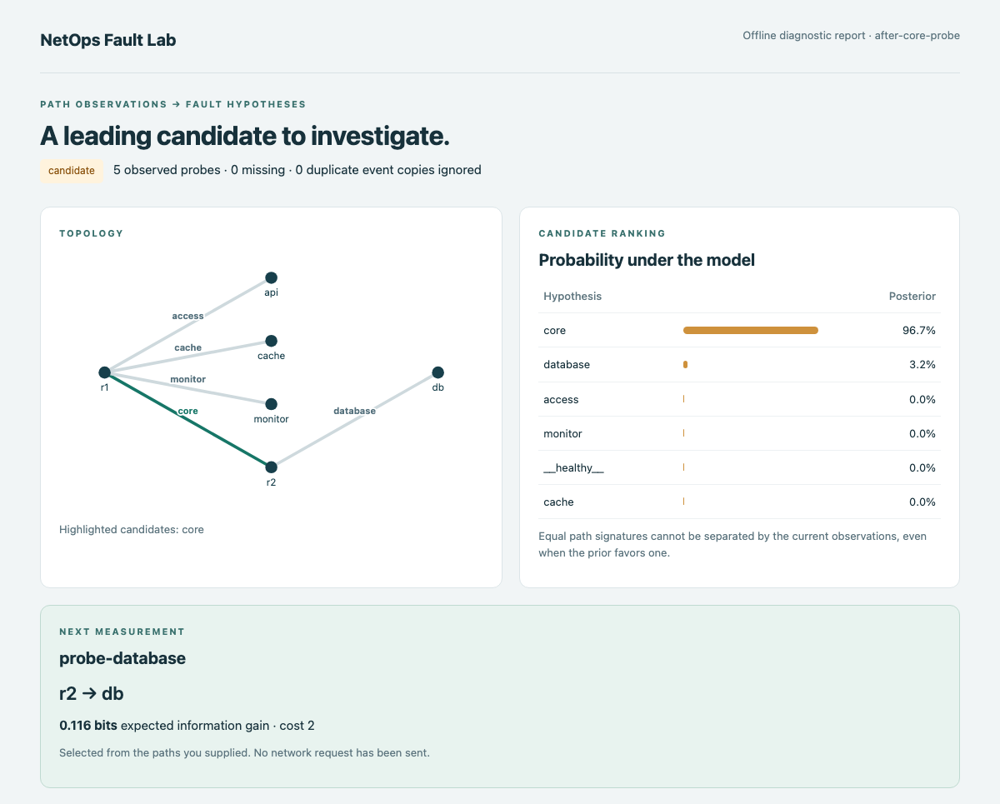

# NetOps Fault Lab

找出可疑链路，再决定下一条该测哪里。

[](https://github.com/crown-sports/netops-fault-lab/actions/workflows/ci.yml)
[Python 3.10+](pyproject.toml) · [v0.2.0 预览版](https://github.com/crown-sports/netops-fault-lab/releases/tag/v0.2.0) · [MIT](LICENSE)

[English](README.md) · [输入格式](docs/input.md) · [算法说明](docs/method.zh-CN.md) · [实验](docs/experiments.md)

到数据库的两条探测都失败，到缓存的探测正常。问题在核心链路，还是数据库接入链路？
这几条路径还不足以区分。NetOps Fault Lab 离线分析已知路径和结果，列出无法区分的候选，
再建议一条能补充信息的探测。

## 补测前：两条链路都能解释现象



*`examples/ambiguous.json` 的 v0.2.0 实际报告。两个候选均为 49.8%，建议下一步测 `r1 → r2`。*

## 补测后：多一条结果，排名变了



*`examples/after-probe.json` 补入一次 `r1 → r2` 失败，core 升到 96.7%。两份输入均为合成样例，工具不会向网络发探测。*

## 跑一下这个例子

```bash
git clone --branch v0.2.0 https://github.com/crown-sports/netops-fault-lab.git
cd netops-fault-lab
python -m venv .venv
```

macOS/Linux 执行 `source .venv/bin/activate`；PowerShell 执行 `.venv\Scripts\Activate.ps1`，然后：

```bash
python -m pip install .
netops-fault-lab diagnose examples/ambiguous.json --format html --output before.html
netops-fault-lab diagnose examples/after-probe.json --format html --output after.html
```

打开两个 HTML 文件。拓扑下面还列出每条观测如何区分候选，以及下一步可测的路径。
输出文件名必须尚不存在。省略 `--format` 和 `--output` 可在终端查看摘要，`--format json` 可供脚本读取。
核心推断只依赖 Python 标准库。

## 换成自己的路径和探测结果

复制 `examples/ambiguous.json` 为 `incident.json`，换成同一观测窗口内的链路、真实路径和结果，
只加入实际能执行的候选探测。[输入说明](docs/input.md)列出了完整字段。

```bash
netops-fault-lab diagnose incident.json --format html --output incident-report.html
```

用现有工具执行建议的探测，把结果写回，再运行一次。退出 `0` 表示报告有效，也包括无法唯一定位的情况；
输入无效返回 `2`。

模型假设路径已知且不变、至多一条链路故障。默认噪声参数用于演示；解读真实概率前，
需要用已标注事件拟合参数，再用留出的数据检验。[模型假设与参数拟合](docs/method.zh-CN.md)。

## 同一告警转发两次，只算一次

```bash
netops-fault-lab diagnose examples/replayed-event.json --format json
```

样例的 5 条记录来自 4 次测量。同一事件的副本共用 `event_id`，报告保留一条、标记一条忽略的副本，
每条记录自身的 `id` 仍然唯一。同一事件若出现冲突路径或结果，会直接报错。
独立重复测量使用不同事件 ID；不带事件 ID 的记录按相互独立处理。

## 继续看实验

合成实验比较失败路径投票、逻辑回归和贝叶斯排名，并测试漏采、重复告警和噪声变化。
贝叶斯排名与逻辑回归接近。在单独的主动探测实验中，同样最多补测 4 次，
信息增益选择的 **Top-1 为 72.5%**，随机选择为 **57.2%**。

这些是仿真结果，不能当成生产网准确率。[数据、逐例结果与复现命令](docs/experiments.md)。

[实现说明](docs/product.md) · [图片来源](docs/screenshots.md) · [贡献指南](CONTRIBUTING.md) · [版本记录](CHANGELOG.md) · [软件引用](CITATION.cff)
